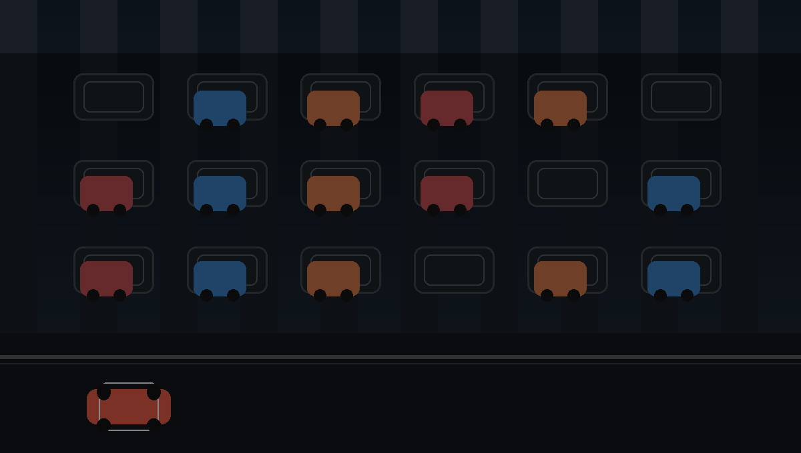

# Parking Lot Space Detector

<p align="center">
  
</p>

<p align="center">
  <a href="#quick-start">
    
  </a>
  <a href="#train-a-model">
    
  </a>
  <a href="#score-a-whole-lot">
    
  </a>
</p>

A smart parking-lot vision pipeline that classifies every parking space as empty,
occupied, or whatever labels your dataset defines, then turns the results into a
single occupancy overview with annotated lot images.

Built on the Roboflow [Parking Lot v10](https://universe.roboflow.com/kaisha/parking-lot-vagxk)
multiclass export: **6,155 cropped space images, 640×640, CC BY 4.0**, with labels
attached to each space rather than to individual cars.

## Why this project?

Parking lots are full of repeated patterns: a few cars, a lot of empty slots, and
many edge cases where a camera angle or partial occlusion flips the label. This
project makes that workflow repeatable:

- classify a single parking space quickly and consistently
- evaluate the model against a held-out test split
- score an entire lot from a fixed slot layout
- draw green/red overlays and compute occupancy percentages

## What it does

| Capability | Details |
| --- | --- |
| Crop-level classification | Identifies whether one parking spot is empty or occupied using a trained image classifier |
| Whole-lot scoring | Reads a lot photo plus slot boxes and produces a labeled occupancy map |
| Annotated output | Renders green/red boxes and writes a JSON summary with confidence values |
| Model flexibility | Works with MobileNetV3, ResNet, ShuffleNet, and EfficientNet backbones |

## How the project is structured

This dataset is a classification problem rather than a detection problem, so the
project has two layers:

1. **Crop classifier** — fine-tunes a CNN backbone for each parking spot image
2. **Lot-level scorer** — takes a full parking lot image and a JSON list of slot
   boxes, then classifies each slot and reports occupancy

This setup is ideal when the lot geometry is fixed and the camera angle stays the
same.

## Quick start

### 1. Install

```bash
python -m venv .venv
# Windows: .venv\Scripts\activate
# macOS/Linux: source .venv/bin/activate

pip install --index-url https://download.pytorch.org/whl/cpu -r requirements.txt
```

Use plain `pip install -r requirements.txt` if you have a CUDA GPU or an Apple
Silicon Mac.

### 2. Prepare your dataset

Point `--data` at the folder exported by Roboflow:

```text
Parking Lot.v10i.multiclass/
    train/empty/*.jpg      train/occupied/*.jpg
    valid/...
    test/...
```

The path you already have — `...\Downloads\Parking Lot.v10i.multiclass` — is the
expected input. Class names are discovered from the folder names, so a 2-class
export (`empty`, `occupied`) or a 3-class one works without modification.

If no `valid/` folder exists, the project auto-creates a validation split from
`train` using `--val-fraction` (default `0.2`). If you only have `train`, that's
still acceptable; point `--data` at the parent export folder so `test/` remains
untouched for the final evaluation.

### 3. Train a model

Windows:

```bat
python -m parking_lot.train --data "C:\Users\DELL\Downloads\Parking Lot.v10i.multiclass" ^
    --out runs/parking-v10 --epochs 12 --img-size 224 --batch-size 64
```

Linux/macOS:

```bash
python -m parking_lot.train \
    --data "$HOME/Downloads/Parking Lot.v10i.multiclass" \
    --out runs/parking-v10 --epochs 12 --img-size 224 --batch-size 64
```

Available backbones include:

- `mobilenet_v3_small` (default, fastest)
- `mobilenet_v3_large`
- `shufflenet_v2_x1_0`
- `resnet18`
- `resnet34`
- `resnet50`
- `efficientnet_b0`

Useful flags:

| Flag | What it does |
| --- | --- |
| `--no-class-weights` | skips inverse-frequency weighting when the dataset is already balanced |
| `--no-pretrained` | trains from scratch without downloading pretrained weights |
| `--patience 0` | disables early stopping |
| `--img-size 320` | helps with smaller or more distant parking spaces |
| `--lr 1e-4` | gentler learning rate for a smaller classification head |

Outputs are written into `--out`:

```text
best.pt / last.pt      checkpoints (arch, class names, image size, normalisation)
history.csv            per-epoch loss / accuracy / macro-F1
metrics.json           best epoch + validation report
config.json            exact arguments used
```

### 4. Evaluate the model

```bash
python -m parking_lot.evaluate \
    --data "C:\Users\DELL\Downloads\Parking Lot.v10i.multiclass" \
    --checkpoint runs/parking-v10/best.pt --out runs/parking-v10
```

This uses `test/` when present; otherwise it falls back to `valid/`. It prints
precision, recall, and F1 by class and writes `confusion_matrix.png` and
`report_test.json`.

> Report the test numbers, not the training log. The exported `test/` split is
> the unbiased estimate.

## Classify individual crops

```bash
python -m parking_lot.predict --checkpoint runs/parking-v10/best.pt --topk 2 some_space.jpg
python -m parking_lot.predict --checkpoint runs/parking-v10/best.pt crops/ --json crops.json
```

## Score a whole lot

Define the slot layout for one camera view in JSON. By default, box coordinates are
in absolute pixels; set `"normalized": true` to use 0–1 values instead.

```json
{
  "image": "lot.jpg",
  "slots": [
    {"id": "A1", "box": [120, 240, 210, 330]},
    {"id": "A2", "box": [220, 240, 310, 330]}
  ]
}
```

Run the lot-level scorer:

```bash
python -m parking_lot.slots --checkpoint runs/parking-v10/best.pt \
    --slots demo/slots.json --out demo/annotated.jpg
```

It prints free/occupied counts and the occupancy percentage, saves the annotated
image, and writes a JSON file including each slot's label, confidence, and box.
Classes whose names contain `empty`, `vacant`, `free`, `available`, `unoccupied`,
`no car`, or `open` are treated as free (override with `--empty-classes empty,vacant`).
Slots under 0.6 confidence are surfaced so a human can verify them.

### Want a demo without a real lot photo?

Build a synthetic lot from the dataset crops:

```bash
python scripts/make_demo_lot.py --data "C:\Users\DELL\Downloads\Parking Lot.v10i.multiclass" \
    --out demo --rows 3 --cols 5
python -m parking_lot.slots --checkpoint runs/parking-v10/best.pt --slots demo/slots.json
```

For a real parking lot, draw each slot box once in any annotation tool (CVAT,
Roboflow, labelImg, etc.) and export those boxes to the JSON above. Since the slot
layout is fixed for a camera view, this is a one-time setup step.

## Project structure

```text
parking_lot/
  data.py        class discovery, splits, transforms, dataloaders
  model.py       torchvision backbones + classifier head swap
  train.py       fine-tuning loop (AMP, cosine LR, early stopping, class weights)
  evaluate.py    test metrics + confusion matrix plot
  predict.py     batch/CLI inference on crops
  slots.py       lot-level occupancy from slot boxes + annotated overlay
  inference.py   checkpoint loading and batched probabilities
  metrics.py     confusion matrix / precision-recall-F1 helpers
scripts/
  make_demo_lot.py   synthetic lot image + slots.json from dataset crops
```

## Known limits

- This is **not** a slot detector: it does not discover new parking spaces from an
  arbitrary image. The geometry is supplied as JSON; the model decides each slot's
  state.
- Accuracy is tied to the camera angle and lot layout in the training data. A new
  mounting point or lot often needs a fresh labelled sample (a few hundred crops
  is typically enough to fine-tune `best.pt`).
- The dataset's 640×640 preprocessing is baked into the images. Keep `--img-size`
  reasonable (224–320) instead of forcing massive values.
- Crops near the edge of a parking space may include parts of neighboring cars,
  which is the main cause of empty/occupied confusion. Tightening the boxes helps.

## License and dataset source

- Dataset: [Parking Lot v10](https://universe.roboflow.com/kaisha/parking-lot-vagxk)
- License: CC BY 4.0
- Project code: use it as a starting point for your own parking-lot monitoring or
  smart city inference pipeline
